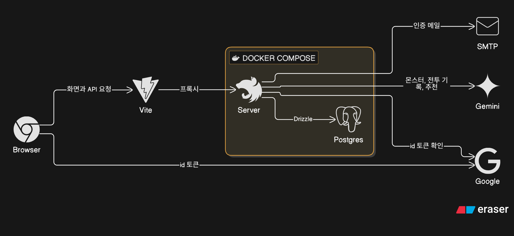
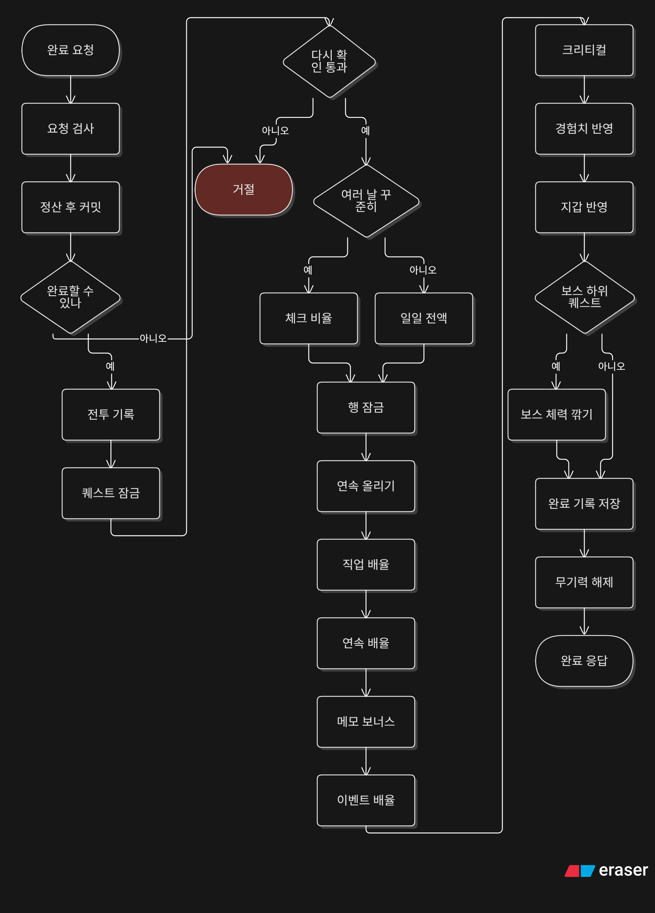
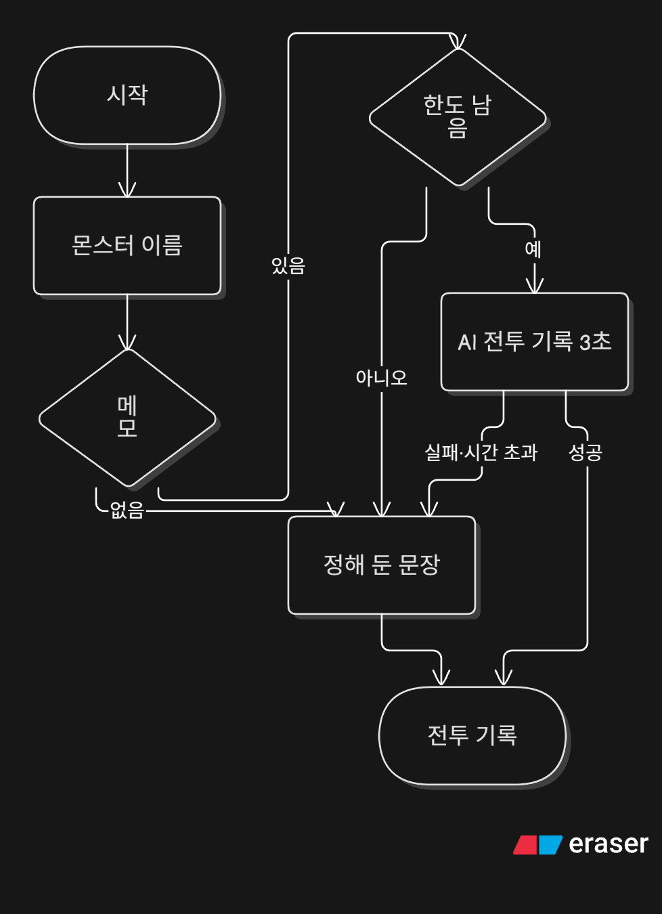
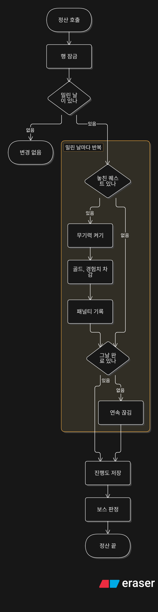

# 아키텍처

할 일을 퀘스트로 등록하고, 완료하면 골드와 경험치를 받는 웹앱이다. 퀘스트는 루틴 또는 기한으로 등록하고, 예정일이 지난 루틴이나 마감이 지난 기한 퀘스트를 완료하지 않으면 정산할 때 골드와 경험치를 깎는다.

## 핵심 설계

1. 패널티는 밀린 날짜를 한꺼번에 정산한다. 마지막 정산일을 기록해 두고, 홈 화면을 열 때와 완료 직전에 호출된다. 서버는 매일 서울 자정 직후에도 모든 사용자를 정산한다. 이유: 앱을 열지 않은 사용자도 그날 안에 정산해서 지갑과 스탯 화면의 값이 정확하게 하려는 것이다. 호출이 겹쳐도 마지막 정산일과 사용자별 잠금 때문에 같은 패널티가 두 번 들어가지 않는다.
2. 완료 요청은 정산을 먼저 커밋한 뒤 완료를 시작한다. 둘은 트랜잭션이 따로다. 이유: 쌓인 패널티를 먼저 반영해야 잔액과 경험치가 정확하고, 완료가 실패해도 정산 결과는 남기려는 것이다.
3. 골드 하한은 -30이다. 이유: 빚이 끝없이 쌓이지 않게 하려는 것이다.
4. 경험치는 현재 레벨의 0까지만 깎고 레벨은 내리지 않는다. 이유: 레벨이 떨어지는 일을 막으려는 것이다.
5. 날짜는 서울 달력으로 센다. 이유: 사용자가 체감하는 하루에 맞추려는 것이다.
6. 구글 계정이 생긴 뒤, 또는 세션이 생긴 뒤에 확인한다. 사용자가 있고 이메일이 아직 인증되지 않았으며 구글 계정이 있을 때만, 이메일을 인증된 것으로 표시하고 이메일 계정(credential)의 비밀번호를 비운다. 비밀번호가 있는지는 보지 않는다. 이유: 미인증 이메일로 먼저 가입해 둔 사람이 나중에 그 계정에 들어오는 일을 막으려는 것이다.
7. 잔액이 바뀔 때마다 종류(완료, 패널티, 사후 차감)와 금액이 지갑 내역에 남는다. 내역에는 어떤 퀘스트 때문인지는 남지 않는다.
8. 로그인은 better-auth이고 세션은 DB의 session 테이블에 저장된다.

## 시스템 구성 (개발 환경 기준)



### 그림에서 안 보이는 점

- 구글 id 토큰은 브라우저가 구글에서 직접 받아 서버 `/api/auth`로 보낸다.
- 이메일 로그인은 메일 인증이 필요하다.
- 개발 중 `/api` 요청은 Vite 개발 서버가 서버로 프록시한다.
- 배포용 Compose는 postgres와 server를 올리고 web은 Compose에 없다.
- 몬스터 큐는 Postgres 테이블이고, 워커는 서버 안에서 돈다. 전투 기록과 추천은 큐를 거치지 않고 서버가 바로 부른다.

## 코드 구조

### 서버 (`server/src/`)

```
auth/                           가입, 로그인 (Better Auth), 이메일 인증, 온보딩, 계정 삭제
  auth.ts                       Better Auth 설정
  job-class.guard.ts            직업이 없는 계정의 앱 API를 막는 전역 가드
quests/                         퀘스트 규칙 전부
  quests.service.ts             등록, 목록, 오늘 체크, 루틴 끄기·켜기, 포기
  bosses.controller.ts          POST /api/bosses, GET /api/bosses
  boss-plan.service.ts          계획을 보스와 하위 퀘스트로 확정하고, 판정 전 보스를 조회한다
  quest-completion.service.ts   완료: 정산 → 잠금 없이 확인 → 전투 기록 → 잠그고 다시 확인 → 지갑과 진행도 갱신
  quest-penalty.service.ts      놓친 날 정산 (놓친 루틴, 지난 기한)
  quest-settlement.scheduler.ts 서울 00:01에 모든 사용자 정산
  quest-crit.roller.ts          크리티컬 판정 (CRIT_FORCE)
  quest-calendar.ts             서울 날짜 계산
wallet/                         잔액, 내역, 사후 차감
progress/                       레벨, 경험치, 칭호, 연속, 뽑기권
stats/                          스탯 합계
job-change/                     직업 변경
ai/                             몬스터, 전투 기록, 난이도 추천, 계획 제안. 지금 구현은 Gemini
  ai.ts                         인터페이스. 골드와 경험치는 정하지 않는다
  ai-call-limiter.ts            바로 부르는 호출(전투 기록, 추천, 계획 제안)만 센다. 큐 워커는 세지 않는다. 서버 메모리에 있어서 서버가 여러 대면 대수만큼 늘어난다
  gemini-ai.ts                  Gemini 호출. 기본 모델 gemini-3.5-flash-lite. Gemini에는 마감을 최소 10초로 보내고, 3초는 우리 쪽에서 끊는다
  difficulty.controller.ts      POST /api/ai/difficulty-recommendations
  difficulty.service.ts         제목만 받아 난이도와 이유 한 줄을 준다
  dto/recommend-difficulty.dto.ts
  quest-plan.controller.ts      POST /api/ai/quest-plans
  quest-plan.service.ts         목표와 마감을 받아, 서버가 센 횟수와 체력이 붙은 하위 퀘스트를 준다
  dto/suggest-quest-plan.dto.ts
ai-queue/                       뒤에서 만드는 몬스터 작업만
  ai-queue.ts                   넣기, 퀘스트별 조회, 꺼내기, 완료, 실패
  postgres-ai-queue.ts          Postgres 큐. 분당 12회, 재시도, FOR UPDATE SKIP LOCKED
  ai-queue.worker.ts            몬스터 작업을 하나 집어 AI 인터페이스를 부른다
database/schema/                Drizzle 테이블 (테이블마다 파일 하나)
common/filters/                 예외를 HTTP 응답으로 바꾸는 필터
```

### 공유 (`shared/src/`)

```
quest-completion.ts   보상표 금액, 직업·연속 배율, 최종 금액, 레벨업
quest-penalty.ts      패널티 금액, 골드·경험치 하한
constants/            보상표, 패널티표, 크리티컬 확률, 직업과 그 밖의 상수
  monsters.ts         몬스터 8종, 그림 키, 목록 상태
  bosses.ts           보스 8종, 그림 키, 진행 상한 3
boss-hp.ts            횟수와 난이도 점수로 하위 퀘스트 체력
types/                서버와 웹이 주고받는 응답 타입
  difficulty-recommendation.ts
```

### 웹 (`web/src/`)

```
routes/        페이지 (파일 이름이 URL): home, quests, stats, wallet, job, sign-up/sign-in/onboarding
components/    페이지마다 폴더 (home, quest, wallet, stats, job, settings, auth)와 공통 ui/
lib/           서버 호출 (quests, wallet, home, stats, jobChange), 화면용 계산 (questReward), 색종이, 효과음, 저장한 설정
composables/   useApi (서버 호출의 입구), useQuestBoard (퀘스트 목록, 완료와 체크 상태)
stores/        로그인 상태와 계정 API 호출 (Pinia)
auth/          Better Auth 클라이언트
i18n/          한국어와 영어 문구
```

### 코드가 지키는 규칙

- 골드, 경험치, 패널티 금액은 `shared`의 함수만 계산한다. 서버는 그 값으로 지급하고, 웹은 같은 함수로 예상만 보여 준다.
- 컨트롤러는 요청만 받아 서비스를 호출한다. 규칙은 서비스에 있다.
- 웹의 서버 호출은 모두 `useApi`를 거친다. 퀘스트·지갑 같은 기능 호출은 `lib/`에 모으고, 계정 API는 `stores/auth.ts`에서 호출한다.

## 서버 내부 구조

주요 호출 관계는 다음과 같다.

- 퀘스트 완료는 정산을 호출한 다음 지갑에 골드를 넣는다.
- 정산은 지갑에서 골드를 깎는다.
- 직업 변경은 지갑에 골드를 넣지 않는다. 레벨과 경험치만 1과 0으로 되돌리고, 마지막 변경 시각부터 7×24시간이 지나기 전에는 다시 바꾸지 못한다.

## 몬스터 작업 흐름

퀘스트를 등록하면 그 퀘스트의 몬스터 작업을 하나 넣고, 응답은 작업을 기다리지 않는다. 퀘스트 id는 작업 열에 저장되고 유일해서, 퀘스트당 작업은 하나다. 페이로드는 제목과 `shared/src/constants/monsters.ts`의 8종이다. 넣기에 실패해도 퀘스트 등록은 유지된다.

워커가 작업을 하나 집어 AI 인터페이스를 부른다. 모델이 종류를 고르고 이름과 설명을 쓴다. 골드와 경험치는 정하지 않는다.

퀘스트 목록은 `findMonsters`로 그 행의 큐 `status`와 `result`를 읽는다. 목록은 이것을 `monsterStatus`와 `monster`로 바꾼다.

- 작업이 없으면 둘 다 null이다.
- `pending` 또는 `running`이면 `generating`이고, `monster`는 null이다.
- `failed`이거나, `succeeded`인데 결과가 알려진 종류와 이름·설명이 아니면 `failed`이고 `monster`는 null이다. 퀘스트 제목은 등록한 그대로다.
- 결과가 맞는 `succeeded`이면 `ready`다. `monster.kind`는 slime, bat, goblin, wolf, orc, skeleton, golem, dragon 중 하나다. `imageKey`는 그 종류와 같다. `name`과 `description`은 결과에서 온다.

보스를 확정하면 트랜잭션이 커밋된 뒤 보스 퀘스트의 작업을 하나 넣는다. 작업 종류는 `monster` 그대로다. 페이로드의 종류는 `shared/src/constants/bosses.ts`의 8종이다. minotaur, hydra, cerberus, kraken, chimera, vampire, giant, abyss_lord. 하위 퀘스트는 각자 몬스터 8종으로 작업을 넣는다. 넣기에 실패해도 보스와 하위 퀘스트는 남는다. `GET /api/bosses`는 그 작업을 같은 방식으로 읽고, 종류만 보스 8종으로 본다. 실패하거나 결과가 맞지 않으면 제목은 목표 문구 그대로다.

## 퀘스트 완료 흐름

<a href="img/quest_complete_flow.png"></a>

### 전투 기록

<a href="img/battle_log_flow.png"></a>

완료 흐름의 '전투 기록 만들기'를 펼친 그림이다.

- 잠금 없이 먼저 확인한다. 메모가 있으면 바로 부르는 한도를 확인한 뒤 전투 기록을 만든다. 제한은 3초다. 그다음 잠그고 다시 확인한다. 전투 기록은 잠금 밖에서 만들어 완료 행에 저장한다.

### 눈여겨볼 점

- 정산이 먼저 커밋된다. 완료가 실패해도 정산은 남는다.
- 루틴은 보상표의 일일 전액이다. 꾸준히 기한은 체크 횟수 비율이다. 당일 기한과 한 번에 기한은 비율 없이 보상표의 일일 전액이다.
- 만든 날과 끝나는 날이 다른 꾸준히 기한만 `POST /api/quests/:id/day-marks`로 체크 횟수가 쌓인다. 한 번에 기한은 오늘 체크를 할 수 없다.
- 꾸준히 기한은 날짜 차이가 1 이상이고 체크가 없으면 골드와 경험치가 0이다. 한 번에 기한은 체크와 상관없이 일일 전액이다. 완료 기록은 남는다. 그 기한 퀘스트는 포기할 수 없다.
- 루틴을 완료하면 상태이상을 지운다. 기한 퀘스트를 완료하면 그대로 둔다.

### 실패

필터는 예외의 상태 코드를 그대로 응답한다.

| 조건                               | 상태 코드 |
| ---------------------------------- | --------- |
| 메모가 500자를 넘는다              | 400       |
| 만든 날보다 앞에서 완료한다        | 400       |
| 루틴인데 오늘이 지정 요일이 아니다 | 400       |
| 루틴인데 오늘이 쉬는 주다          | 400       |
| 기한 밖이다                        | 400       |
| 정산 단계에서 직업이 없다          | 403       |
| 보상 계산 단계에서 직업이 없다     | 403       |
| 퀘스트 id 형식이 아니다            | 404       |
| 내 퀘스트가 아니다                 | 404       |
| 루틴을 오늘 이미 완료했다          | 409       |
| 기한 퀘스트를 이미 완료했다        | 409       |

### 보상 계산

루틴은 날짜 차이를 0으로 둔다. 그러면 보상표의 일일 전액이다.

꾸준히 기한은 만든 날과 완료일의 날짜 차이다. 0이면 일일 보상표다. 1부터 7이면 주간 보상표다. 8 이상이면 장기 보상표다. 한 번에 기한은 일일 보상표이고 비율은 1이라, 결과의 체크 횟수와 경과 일수는 둘 다 1이다.

꾸준히 기한은 날짜 차이가 1 이상이면 경과 일수가 양 끝을 포함한 날 수다. 체크 횟수는 그 일수를 넘지 않는다. 보상은 보상표 금액에 체크 횟수 / 경과 일수를 곱한다. 한 번에 기한은 체크와 상관없이 일일 전액이다.

직업과 카테고리 스탯에 따라 배율이 붙는다. 운동과 생활은 체력, 학습과 업무는 지성, 창작과 마음은 감성이다.

연속 일수가 3일 이상이면 연속 배율도 골드와 경험치에 곱한다. `1~2`일은 1, `3~6`일은 1.1, `7~29`일은 1.2, `30`일 이상은 1.5다. 기한 퀘스트도 포함한다. 그날 첫 완료를 누르는 순간 일수가 오르고, 그 완료부터 새 일수로 계산한다.

메모가 있으면 그 결과에 10%를 더해 반올림한다. 메모가 없으면 더하지 않는다.

골드에는 크리티컬이 붙을 수 있다. 완료할 때마다 10% 확률로 터지고, 터지면 90%는 2배, 10%는 3배다. 전체로 보면 2배가 9%, 3배가 1%다. 경험치에는 적용하지 않는다. 완료 직전 잔액이 0보다 작으면 굴리지 않는다. 직업 배율, 연속 배율, 메모, 크리티컬은 각각 곱한 뒤 마지막에 한 번만 반올림한다.

완료 응답의 `applied`에는 계산에 쓰인 기본 금액, 체크 횟수와 경과 일수, 직업 배율, 연속 배율, 메모 보너스, 크리티컬 배수가 담긴다.

### 경험치와 레벨

| 지금 레벨 | 다음 레벨까지 경험치                  |
| --------- | ------------------------------------- |
| 1–10      | 100                                   |
| 11–30     | 200                                   |
| 31–49     | 400                                   |
| 50        | 더 오르지 않는다. 레벨 경험치는 0이다 |

레벨이 오를 때마다 뽑기권이 1장 늘어난다. 도달 레벨이 10, 20, 30, 40, 50이면 칭호를 준다.

## 패널티 정산 흐름

<a href="img/penalty_flow.png"></a>

어제는 서울 달력의 오늘에서 하루 전이다. 마지막 정산일이 어제와 같거나 그 뒤면 정산하지 않는다. 그보다 앞이면, 그 다음 날부터 어제까지 하루씩 본다. 오늘은 정산하지 않는다.

### 눈여겨볼 점

- 골드와 경험치 차감의 대상은 현재 루틴과, 마감일이 지난 기한 퀘스트다. 무기력은 루틴 미달에만 켜진다.
- 예정 루틴이 없는 날은 상태이상을 바꾸지 않는다. 그 날 완료가 없으면 연속만 0이 된다.
- 연속은 첫 완료에서만 오르고, 정산은 완료가 없는 지난날만 0으로 만든다.
- 오늘은 정산하지 않는다.
- 레벨은 이 정산에서 바뀌지 않는다.
- 기한 퀘스트는 마감일에 완료하지 못했을 때 마감일 다음 날 이후 첫 정산에서 한 번만 깎는다. 완료한 퀘스트는 대상이 아니다.

### 규칙

| 규칙               | 값                                                                                                                                                                                                                                                |
| ------------------ | ------------------------------------------------------------------------------------------------------------------------------------------------------------------------------------------------------------------------------------------------- |
| 쉬움 패널티        | 골드 5, 경험치 5                                                                                                                                                                                                                                  |
| 보통 패널티        | 골드 10, 경험치 10                                                                                                                                                                                                                                |
| 어려움 패널티      | 골드 20, 경험치 20                                                                                                                                                                                                                                |
| 골드 하한          | -30. 쉬움 일일 골드 10에 3을 곱한 값이다. 넘는 차감은 버린다                                                                                                                                                                                      |
| 경험치 하한        | 현재 레벨 경험치의 0. 레벨 숫자는 내리지 않는다                                                                                                                                                                                                   |
| 연속 일수          | 그날 첫 완료에서 1이 오른다. 완료가 없는 지난날은 정산에서 0이 된다. 정산은 연속을 올리지 않는다                                                                                                                                                  |
| 무기력             | 놓친 루틴이 있으면 `lethargy`가 된다. 예정 루틴이 없는 날은 상태이상을 바꾸지 않는다                                                                                                                                                              |
| 기한 퀘스트 패널티 | 꾸준히는 만든 날부터 마감일까지의 간격으로 고른다. 0일은 쉬움 5, 보통 10, 어려움 20이다. 1일부터 7일은 10, 20, 40이다. 8일 이상은 15, 30, 60이다. 한 번에는 간격과 상관없이 일일 열이다. 골드와 경험치에 같은 수다. 연속과 무기력은 바꾸지 않는다 |
