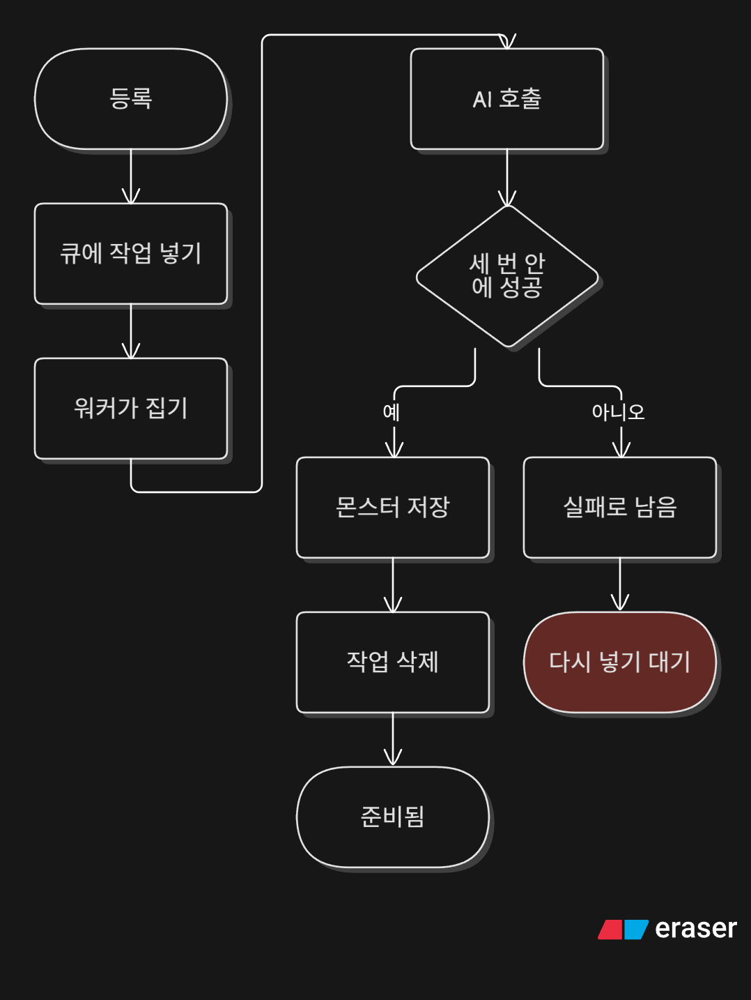
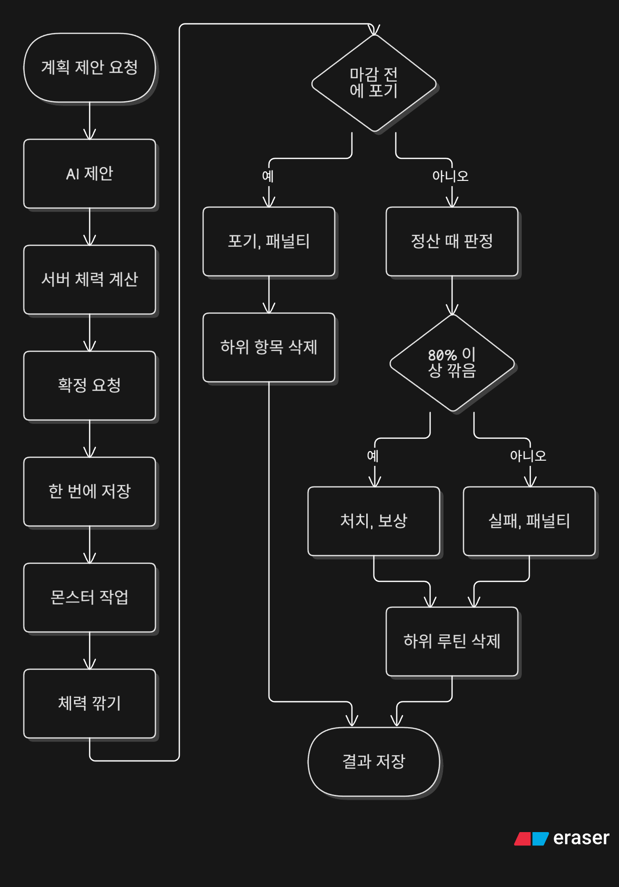

# 아키텍처

할 일을 퀘스트로 등록하고, 완료하면 골드와 경험치를 받는 웹앱이다. 기한 퀘스트는 그 자체로 등록한다. 루틴은 예정일마다 그날 마감인 한 번에 퀘스트를 하나 찍는다. 그 퀘스트나 다른 기한 퀘스트를 마감까지 완료하지 않으면 정산할 때 골드와 경험치를 깎는다.

보상, 패널티, 레벨 같은 규칙과 금액은 [README](../README.ko.md)에 있다. 이 문서는 구조와 흐름만 다룬다.

## 핵심 설계

1. 패널티는 밀린 날짜를 한꺼번에 정산한다. 마지막 정산일을 기록해 두고, 홈 화면을 열 때와 완료 직전에 호출된다. 서버는 매일 앱 시간대 자정 직후에도 모든 사용자를 정산한다. 이유: 앱을 열지 않은 사용자도 그날 안에 정산해서 지갑과 스탯 화면의 값이 정확하게 하려는 것이다. 호출이 겹쳐도 마지막 정산일과 사용자별 잠금 때문에 같은 패널티가 두 번 들어가지 않는다.
2. 완료 요청은 정산을 먼저 커밋한 뒤 완료를 시작한다. 둘은 트랜잭션이 따로다. 이유: 쌓인 패널티를 먼저 반영해야 잔액과 경험치가 정확하고, 완료가 실패해도 정산 결과는 남기려는 것이다.
3. 골드는 정해 둔 하한 아래로 내려가지 않는다. 이유: 빚이 끝없이 쌓이지 않게 하려는 것이다.
4. 경험치는 현재 레벨의 0까지만 깎고 레벨은 내리지 않는다. 이유: 레벨이 떨어지는 일을 막으려는 것이다.
5. 날짜는 앱 시간대 달력으로 센다. 시간대는 `APP_TIME_ZONE` 한 곳에 있고, 서버는 오늘 날짜를 `appCalendarDate`로 구한다. 이유: 사용자가 체감하는 하루에 맞추려는 것이다.
6. 하루 생성·AI 버튼 횟수는 `user_daily_usage`(사용자마다 앱 시간대 하루 한 행)에 둔다. 진행도에 두지 않는다. 이유: 등록이 완료와 같은 진행 행을 잠그지 않게 하려는 것이다.

## 시스템 구성 (개발 환경 기준)


### 그림에서 안 보이는 점

- 로그인은 better-auth이고 세션은 DB의 session 테이블에 저장된다.
- 구글 id 토큰은 브라우저가 구글에서 직접 받아 서버 `/api/auth`로 보낸다.
- 이메일 로그인은 메일 인증이 필요하다.
- 개발 중 `/api` 요청은 Vite 개발 서버가 서버로 프록시한다.
- 배포용 Compose는 postgres와 server를 올리고 web은 Compose에 없다.
- 몬스터 큐는 Postgres 테이블이고, 워커는 서버 안에서 돈다. 전투 기록과 추천은 큐를 거치지 않고 서버가 바로 부른다.

## 코드 구조

### 서버 (`server/src/`)

```
auth/                           가입, 로그인 (Better Auth), 이메일 인증, 온보딩, 계정 삭제
  auth.ts                       Better Auth 설정
admin/                          관리자 사용자 관리, 공지, 보상 이벤트
quests/                         퀘스트, 루틴, 보스 규칙 전부
  quests.service.ts             등록, 목록, 삭제
  quest-completion.service.ts   완료
  quest-penalty.service.ts      놓친 날 정산
  quest-settlement.scheduler.ts 매일 자정 직후 모든 사용자 정산
  routine-spawn.service.ts      루틴이 오늘 퀘스트를 찍는다
  boss-plan.service.ts          보스 확정과 조회
  boss-judgment.service.ts      보스 판정과 포기
wallet/                         잔액, 내역, 사후 차감
shop/                           상점 목록, 직접 등록, 구매
progress/                       레벨, 경험치, 칭호, 연속, 뽑기권
stats/                          체력·지성·감성
job-change/                     직업 변경
limits/                         사람마다 하루 생성·AI 버튼 횟수
ai/                             AI 인터페이스와 지금 구현(Gemini). 몬스터, 전투 기록, 난이도 추천, 계획 제안
ai-queue/                       뒤에서 만드는 몬스터 작업의 큐와 워커
database/schema/                Drizzle 테이블 (테이블마다 파일 하나)
common/filters/                 예외를 HTTP 응답으로 바꾸는 필터
```

### 공유 (`shared/src/`)

```
quest-completion.ts   보상 금액, 배율, 레벨업
quest-penalty.ts      패널티 금액, 골드·경험치 하한
boss-hp.ts            하위 퀘스트 체력
boss-reward.ts        보스 처치 기준, 처치 보상과 실패 패널티
quest-calendar.ts     앱 달력 날짜 계산
account-status.ts     정지가 아직 유효한지 판단
constants/            보상표, 패널티표, 하루 한도, 몬스터·보스 종류와 그 밖의 상수
types/                서버와 웹이 주고받는 응답 타입
```

### 웹 (`web/src/`)

```
routes/        페이지 (파일 이름이 URL)
components/    페이지마다 폴더와 공통 ui/, 앱 셸과 관리자 셸은 layouts/
lib/           기능별 서버 호출, 화면용 계산
composables/   useApi (서버 호출의 입구), useQuestBoard (퀘스트 목록, 완료와 체크 상태)
stores/        로그인 상태와 계정 API 호출 (Pinia)
auth/          Better Auth 클라이언트
i18n/          한국어와 영어 문구
```

몬스터, 보스, 캐릭터 그림은 `web/public/` 아래에 있다.

### 코드가 지키는 규칙

- 골드, 경험치, 패널티 금액은 `shared`의 함수만 계산한다. 서버는 그 값으로 지급하고, 웹은 같은 함수로 예상만 보여 준다.
- 컨트롤러는 요청만 받아 서비스를 호출한다. 규칙은 서비스에 있다.
- 웹의 서버 호출은 모두 `useApi`를 거친다. 퀘스트·지갑 같은 기능 호출은 `lib/`에 모으고, 계정 API는 `stores/auth.ts`에서 호출한다.
- 한 사용자의 행을 같이 바꿀 때는 이 순서로 잠근다. ai_tasks, 루틴, 퀘스트, 사용자, user_daily_usage, user_rewards, 지갑, 진행도, 보스. 삭제와 완료가 같은 순서로 잠가서 서로 기다리지 않는다.

## 서버 내부 구조

주요 호출 관계는 다음과 같다.

- 퀘스트 완료는 정산을 호출한 다음 골드와 경험치를 넣는다. 하위 퀘스트면 보스 체력도 깎는다. 보상 이벤트가 켜져 있으면 그 배율을 완료 골드와 경험치에 곱한다.
- 정산은 놓친 퀘스트의 골드와 경험치를 깎은 다음, 마감이 지난 보스를 판정한다.
- 퀘스트 목록과 보스 읽기는 `prepareForRead`를 같이 쓴다. 순서는 정산, 판정이 끝난 보스의 하위 루틴 삭제, 오늘 퀘스트 찍기다. 자정 직후 작업도 같은 순서다.
- 정지된 계정은 로그인과 앱 API에서 거절한다. 웹은 그 응답을 받으면 세션을 비우고 로그인 화면으로 보낸다.
- 직업 변경은 지갑을 건드리지 않고 진행도의 레벨과 경험치만 되돌린다.
- 상점 구매는 지갑에서 골드를 깎고 내역을 남긴다. 보유 골드가 모자라면 거절한다.
- 등록과 보스 확정은 하루 생성 횟수를, 난이도 추천과 계획 제안은 하루 AI 버튼 횟수를 `user_daily_usage`에서 센다. 한도를 넘으면 거절한다.

## 루틴 찍기

켜진 루틴은 예정일마다 퀘스트를 하나 찍는다. 그 퀘스트는 그날 마감인 한 번에 기한이다. 루틴의 카테고리, 제목, 난이도, 보스, 몬스터를 복사한다. 루틴은 찍은 날짜를 남기므로 그날은 한 번만 찍힌다. 그 퀘스트를 지우거나, 같은 날 끄고 다시 켜도 다시 찍지 않는다.

## 몬스터 작업 흐름

<a href="img/monster_task_flow.png"></a>

기한 퀘스트, 루틴, 보스를 등록하면 몬스터 작업을 큐에 넣는다. 응답은 작업을 기다리지 않는다. 넣기에 실패해도 퀘스트, 루틴, 보스는 남는다.

워커가 작업을 하나 집어 AI 인터페이스를 부른다. 모델이 종류를 고르고 이름과 설명을 쓴다. 골드와 경험치는 정하지 않는다. 성공하면 결과를 `monsters`에 넣고, 퀘스트·루틴·보스가 그 id를 저장한 뒤 작업을 지운다. 실패하면 세 번까지 다시 시도한다. 그래도 실패하면 작업이 실패 상태로 남고 몬스터 행은 없다.

실패한 작업만 사용자가 다시 넣을 수 있다. 이때 제목은 등록 때가 아니라 지금 제목을 쓴다. 목록은 몬스터 행과 큐에 남은 작업을 같이 읽어서 준비됨, 만드는 중, 실패를 구분한다.

## 난이도 추천

서버는 그 사용자의 최근 완료 수와 놓친 수를 세어 제목, 카테고리와 함께 AI 인터페이스에 보낸다. 모델은 난이도와 이유 한 줄만 돌려준다. 금액은 정하지 않는다.

## 보스 계획 흐름

<a href="img/boss_flow.png"></a>

계획 제안은 AI 인터페이스를 직접 부른다. 모델은 하위 퀘스트만 제안하고 횟수와 체력은 정하지 않는다. 둘은 서버가 `shared`의 `bossQuestHp`로 센다.

확정은 보스, 하위 기한 퀘스트, 하위 루틴을 한 트랜잭션에 넣는다. 요청에는 체력이 없다. 서버가 요청의 하위 퀘스트로 체력을 센다. 트랜잭션이 실패하면 아무것도 생기지 않는다.

몬스터 작업은 커밋된 뒤에 넣는다. 넣기에 실패해도 보스와 하위 항목은 남는다.

## 보스 판정

보스 계획 흐름 그림의 판정 부분이다. 판정은 정산의 끝에서, 놓친 날을 반영한 뒤, 그 트랜잭션이 커밋되기 전에 돈다. 마감이 지났고 결과가 아직 비어 있는 보스를 한 번 판정한다. 깎은 체력이 최대 체력의 80% 이상이면 처치이고, 아니면 실패다. 보스 행은 지우지 않고 결과를 그 행에 저장한다.

포기하면 판정을 기다리지 않고 바로 결과를 적고, 하위 루틴과 안 끝난 하위 퀘스트를 지운다.

## 퀘스트 완료 흐름

<a href="img/quest_complete_flow.png"></a>

정산이 먼저 커밋된다. 완료가 실패해도 정산은 남는다.

### 전투 기록

<a href="img/battle_log_flow.png"></a>

완료 흐름의 '전투 기록'을 펼친 그림이다. 잠금 없이 먼저 확인해서, 거절될 요청에는 AI를 부르지 않는다. 그다음 전투 기록을 만들고, 잠근 뒤 다시 확인한다. AI를 기다리는 사이에 상태가 바뀔 수 있어서다.

## 패널티 정산 흐름

<a href="img/penalty_flow.png"></a>

어제는 앱 달력의 오늘에서 하루 전이다. 마지막 정산일이 어제와 같거나 그 뒤면 정산하지 않는다. 그보다 앞이면, 그 다음 날부터 어제까지 하루씩 본다. 오늘은 정산하지 않는다.
