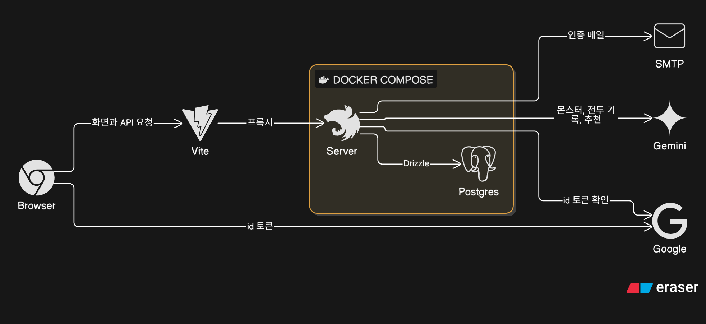
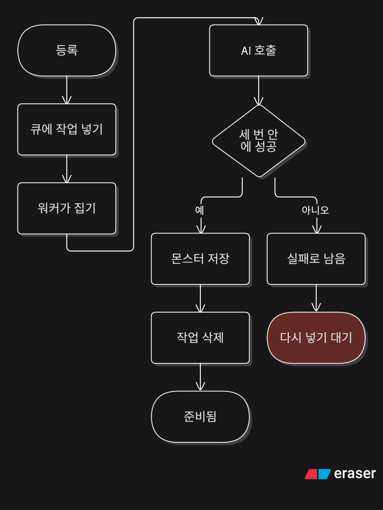
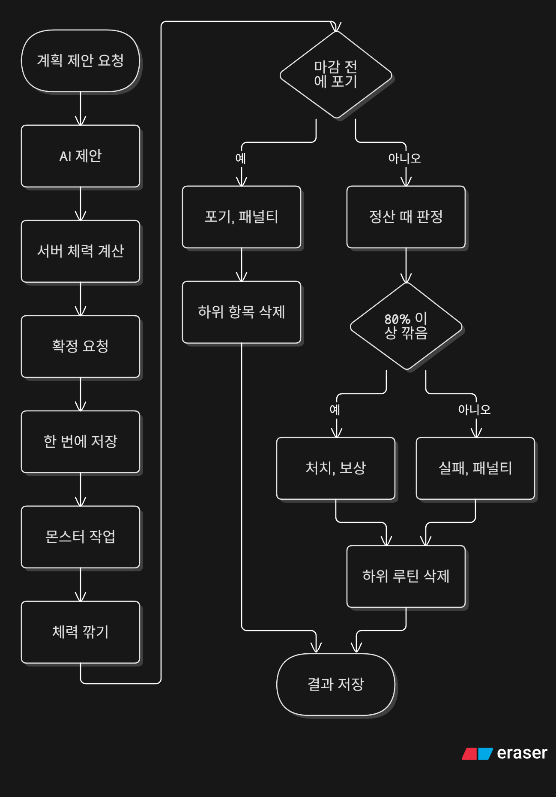
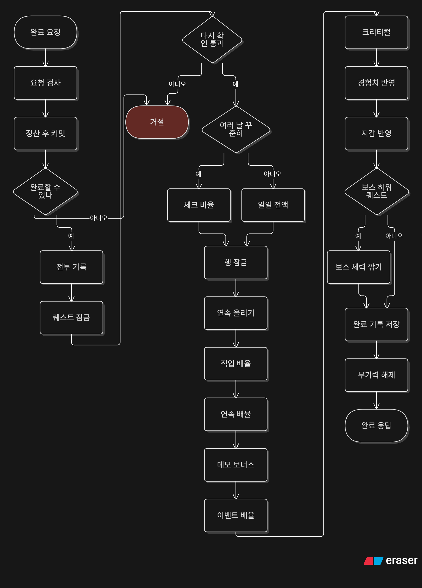
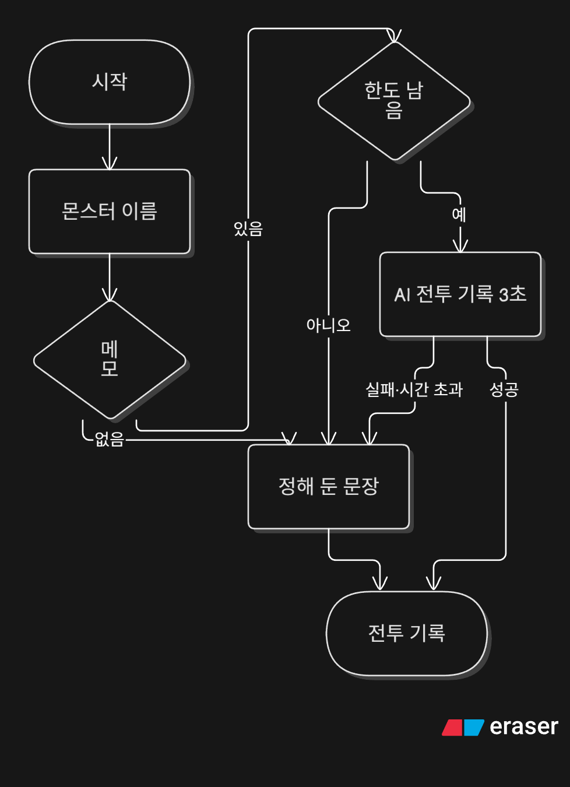
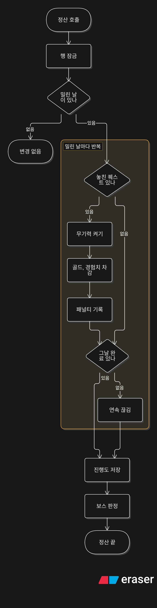

# Architecture

<p align="center"><a href="./ARCHITECTURE.ko.md">한국어</a></p>

A web app where you register a to-do as a quest and receive gold and XP when you complete it. A deadline quest is registered on its own. A routine writes one all-at-once quest, due that day, on each scheduled day. If that quest or another deadline quest is not completed by its due date, settlement deducts gold and XP.

Rules such as rewards, penalties and levels, and the amounts, are in the [README](../README.md). This document covers only structure and flows.

## Core design

1. Penalties settle missed days all at once. The last settled date is recorded, and settlement is called when the home screen opens and right before a completion. The server also settles every user just after midnight in the app time zone each day. Why: so that users who do not open the app are still settled that day, and the wallet and stats screens stay correct. Overlapping calls do not apply the same penalty twice, because of the last settled date and a per-user lock.
2. A completion request commits settlement first, then starts the completion. The two are separate transactions. Why: accumulated penalties must be applied first for the balance and XP to be correct, and the settlement result should remain if the completion fails.
3. Gold does not fall below a set floor. Why: to keep debt from piling up without end.
4. XP is deducted only down to 0 of the current level, and the level does not drop. Why: to stop the level from falling.
5. Days are counted on the app time zone calendar. The time zone lives in one place, `APP_TIME_ZONE`, and the server gets today's date with `appCalendarDate`. Why: to match the day the user experiences.
6. Daily create and AI-button counts live on `user_daily_usage` (one row per user per day in the app time zone), not on progress. Why: so registration does not lock the same progress row as a completion.

## System (development environment)



### Not shown in the diagram

- Sign-in is better-auth, and the session is stored in the `session` table in the DB.
- The browser gets the Google ID token from Google directly and sends it to the server `/api/auth`.
- Email sign-in requires email verification.
- During development, the Vite dev server proxies `/api` requests to the server.
- Production Compose starts postgres and server. Web is not in Compose.
- The monster queue is a Postgres table, and the worker runs inside the server. Battle logs and recommendations do not go through the queue. The server calls them directly.

## Code structure

### Server (`server/src/`)

```
auth/                           sign-up, sign-in (Better Auth), email verification, onboarding, account deletion
  auth.ts                       Better Auth configuration
admin/                          admin user management, announcements, reward events
quests/                         every quest, routine and boss rule
  quests.service.ts             register, list, delete
  quest-completion.service.ts   completion
  quest-penalty.service.ts      settle missed days
  quest-settlement.scheduler.ts settle every user just after midnight each day
  routine-spawn.service.ts      a routine writes today's quest
  boss-plan.service.ts          confirm a boss and read it
  boss-judgment.service.ts      boss judgment and abandon
wallet/                         balance, history, post-hoc deduction
shop/                           shop list, custom registration, purchase
progress/                       level, XP, titles, streak, gacha tickets
stats/                          stamina, intellect, sense
job-change/                     job change
limits/                         per-person daily create and AI-button counts
ai/                             AI interface and the current implementation (Gemini). Monsters, battle logs, difficulty recommendations, plan suggestions
ai-queue/                       queue and worker for monster tasks made in the background
database/schema/                Drizzle tables (one file per table)
common/filters/                 filter that turns exceptions into HTTP responses
```

### Shared (`shared/src/`)

```
quest-completion.ts   reward amounts, multipliers, level-up
quest-penalty.ts      penalty amounts, gold and XP floors
boss-hp.ts            subquest HP
boss-reward.ts        boss clear line, clear reward and fail penalty
quest-calendar.ts     app calendar date calculation
account-status.ts     whether a suspension is still in force
constants/            reward table, penalty table, daily limits, monster and boss kinds, and other constants
types/                response types the server and the web exchange
```

### Web (`web/src/`)

```
routes/        pages (the file name is the URL)
components/    a folder per page and shared ui/; the app shell and the admin shell are layouts/
lib/           server calls by feature, calculations for the screen
composables/   useApi (the entry for server calls), useQuestBoard (quest list, completion and check state)
stores/        sign-in state and account API calls (Pinia)
auth/          Better Auth client
i18n/          Korean and English copy
```

Monster, boss and character pictures live under `web/public/`.

### Rules the code keeps

- Gold, XP and penalty amounts are calculated only by functions in `shared`. The server pays those amounts, and the web uses the same functions only to show an estimate.
- A controller only receives the request and calls a service. Rules live in the service.
- Every server call from the web goes through `useApi`. Feature calls such as quests and the wallet are collected in `lib/`, and account APIs are called from `stores/auth.ts`.
- When rows of one user change together, lock them in this order: ai_tasks, routines, quests, user, user_daily_usage, user_rewards, wallet, progress, bosses. Delete and completion lock in the same order, so they do not wait on each other.

## Inside the server

The main call relations are as follows.

- Quest completion calls settlement, then adds gold and XP. A subquest also cuts the boss HP. If a reward event is on, that multiplier is applied to the completion gold and XP.
- Settlement deducts gold and XP for missed quests, then judges bosses whose due date has passed.
- The quest list and boss reads share `prepareForRead`. The order is settlement, deletion of subroutines whose boss judgment is done, then writing today's quests. The job just after midnight uses the same order.
- A suspended account is refused at sign-in and on app APIs. When the web receives that response, it clears the session and sends the user to the sign-in screen.
- A job change does not touch the wallet. It only rolls back the level and XP on progress.
- A shop purchase deducts gold from the wallet and leaves a history entry. If the gold on hand is short, the purchase is refused.
- Registration and boss confirmation count a daily create, and difficulty recommendations and plan suggestions count a daily AI-button use, on `user_daily_usage`. Over the limit, the call is refused.

## Routine spawn

An active routine writes one quest on each scheduled day. That quest is an all-at-once deadline due that day. It copies the routine's category, title, difficulty, boss and monster. The routine records the date it wrote, so that day is written only once. Deleting that quest, or turning the routine off and on again the same day, does not write it again.

## Monster task flow

<a href="img/monster_task_flow.png"></a>

Registering a deadline quest, a routine or a boss enqueues a monster task. The response does not wait for the task. If the enqueue fails, the quest, routine or boss stays.

The worker picks up one task and calls the AI interface. The model picks a kind and writes a name and a description. It does not set gold or XP. On success the result is inserted into `monsters`, the quest, routine or boss stores that id, and the task is deleted. On failure it retries up to three times. If it still fails, the task stays failed and there is no monster row.

Only a failed task can be enqueued again, and only by the user. The title used then is the current title, not the title at registration. The list reads the monster row and any task still in the queue together, and distinguishes ready, generating and failed.

## Difficulty recommendation

The server counts that user's recent completions and misses and sends them to the AI interface with the title and the category. The model returns only a difficulty and one line of reason. It does not set an amount.

## Boss plan flow

<a href="img/boss_flow.png"></a>

A plan suggestion calls the AI interface directly. The model suggests only subquests and does not set the count or the HP. The server counts both with `bossQuestHp` in `shared`.

Confirmation inserts the boss, the deadline subquests and the subroutines in one transaction. The request carries no HP. The server counts HP from the subquests in the request. If the transaction fails, nothing is created.

Monster tasks are enqueued after the commit. If an enqueue fails, the boss and its sub-items stay.

## Boss judgment

This is the judgment part of the boss plan flow diagram. Judgment runs at the end of settlement, after the missed days are applied and before that transaction commits. A boss whose due date has passed and whose result is still empty is judged once. If the HP cut is 80% or more of max HP, it is a clear. Otherwise it is a failure. The boss row is not deleted. The result is stored on that row.

Abandoning writes the result immediately, without waiting for judgment, and deletes the subroutines and the unfinished subquests.

## Quest completion flow

<a href="img/quest_complete_flow.png"></a>

Settlement is committed first. If the completion fails, the settlement stays.

### Battle log

<a href="img/battle_log_flow.png"></a>

This diagram expands 'battle log' in the completion flow. It checks first without a lock, so a request that will be refused does not call the AI. Then it makes the battle log, locks, and checks again, because the state can change while it waits for the AI.

## Penalty settlement flow

<a href="img/penalty_flow.png"></a>

Yesterday is the day before today on the app calendar. If the last settled date is yesterday or later, nothing is settled. If it is earlier, each day from the next day through yesterday is checked. Today is not settled.
