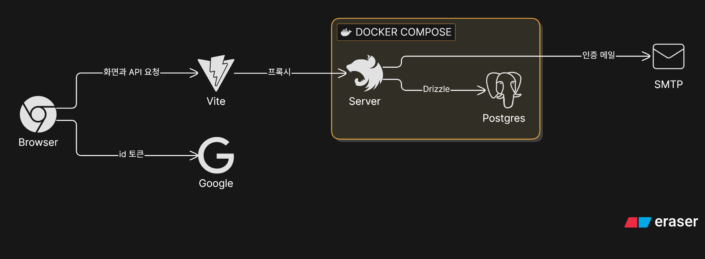
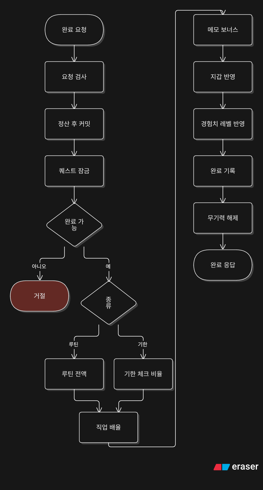
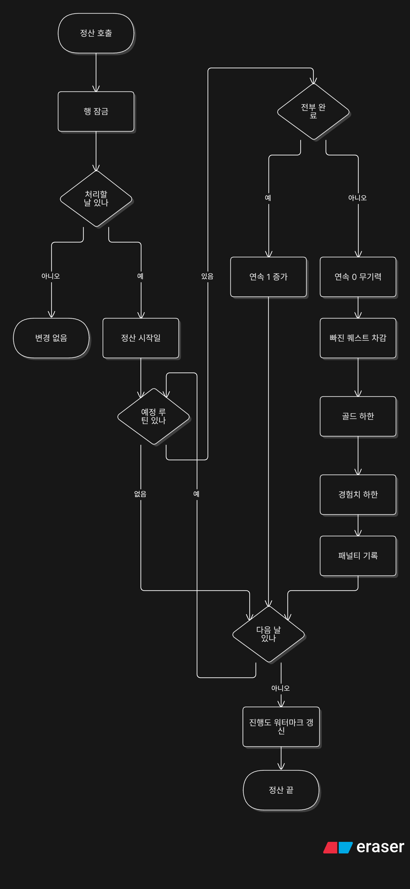

# 아키텍처

할 일을 퀘스트로 등록하고, 완료하면 골드와 경험치를 받는 웹앱이다. 퀘스트는 루틴 또는 기한으로 등록하고, 예정일이 지난 루틴을 완료하지 않으면 정산할 때 골드와 경험치를 깎는다.

## 핵심 설계

1. 패널티는 정해진 시각에 도는 작업이 아니라, 호출될 때 밀린 날짜를 한꺼번에 정산한다. 마지막 정산일을 기록해 둔다. 이유: 상시 도는 작업 없이도 접속 시점에 따라잡으려는 것이다.
2. 완료 요청은 정산을 먼저 커밋한 뒤 완료를 시작한다. 둘은 트랜잭션이 따로다. 이유: 쌓인 패널티를 먼저 반영해야 잔액과 경험치가 정확하고, 완료가 실패해도 정산 결과는 남기려는 것이다.
3. 골드 하한은 -30이다. 이유: 빚이 끝없이 쌓이지 않게 하려는 것이다.
4. 경험치는 현재 레벨의 0까지만 깎고 레벨은 내리지 않는다. 이유: 레벨이 떨어지는 일을 막으려는 것이다.
5. 날짜는 서울 달력으로 센다. 이유: 사용자가 체감하는 하루에 맞추려는 것이다.
6. 구글 계정이 생긴 뒤, 또는 세션이 생긴 뒤에 확인한다. 사용자가 있고 이메일이 아직 인증되지 않았으며 구글 계정이 있을 때만, 이메일을 인증된 것으로 표시하고 이메일 계정(credential)의 비밀번호를 비운다. 비밀번호가 있는지는 보지 않는다. 이유: 미인증 이메일로 먼저 가입해 둔 사람이 나중에 그 계정에 들어오는 일을 막으려는 것이다.
7. 잔액이 바뀔 때마다 종류(완료, 패널티, 사후 차감)와 금액이 지갑 내역에 남는다. 내역에는 어떤 퀘스트 때문인지는 남지 않는다.
8. 로그인은 better-auth이고 세션은 DB의 session 테이블에 저장된다.

## 시스템 구성 (개발 환경 기준)

### 그림에서 안 보이는 점

- 구글 id 토큰은 브라우저가 구글에서 직접 받아 서버 `/api/auth`로 보낸다.
- 이메일 로그인은 메일 인증이 필요하다.
- 개발 중 `/api` 요청은 Vite 개발 서버가 서버로 프록시한다.
- 배포용 Compose는 postgres와 server를 올리고 web은 Compose에 없다.

## 서버 내부 구조

주요 호출 관계는 다음과 같다.

- 퀘스트 완료는 정산을 호출한 다음 지갑에 골드를 넣는다.
- 정산은 지갑에서 골드를 깎는다.
- 직업 변경은 지갑에 골드를 넣지 않는다. 레벨과 경험치만 1과 0으로 되돌리고, 마지막 변경 시각부터 7×24시간이 지나기 전에는 다시 바꾸지 못한다.

## 퀘스트 완료 흐름

### 눈여겨볼 점

- 정산이 먼저 커밋된다. 완료가 실패해도 정산은 남는다.
- 루틴은 보상표의 일일 전액이다. 기한은 체크 횟수 비율이다. 당일 기한은 비율 없이 보상표의 일일 전액이다.
- 만든 날과 끝나는 날이 다른 기한 퀘스트만 `POST /api/quests/:id/day-marks`로 체크 횟수가 쌓인다.
- 날짜 차이가 1 이상이고 체크가 없으면 골드와 경험치는 0이다. 완료 기록은 남는다. 그 기한 퀘스트는 포기할 수 없다.
- 루틴을 완료하면 상태이상을 지운다. 기한 퀘스트를 완료하면 그대로 둔다.

### 실패

필터는 예외의 상태 코드를 그대로 응답한다.

| 조건                               | 상태 코드 |
| ---------------------------------- | --------- |
| 메모가 500자를 넘는다              | 400       |
| 만든 날보다 앞에서 완료한다        | 400       |
| 루틴인데 오늘이 지정 요일이 아니다 | 400       |
| 루틴인데 오늘이 쉬는 주다          | 400       |
| 기한 밖이다                        | 400       |
| 정산 단계에서 직업이 없다          | 403       |
| 보상 계산 단계에서 직업이 없다     | 403       |
| 퀘스트 id 형식이 아니다            | 404       |
| 내 퀘스트가 아니다                 | 404       |
| 루틴을 오늘 이미 완료했다          | 409       |
| 기한 퀘스트를 이미 완료했다        | 409       |

### 보상 계산

루틴은 날짜 차이를 0으로 둔다. 그러면 보상표의 일일 전액이다.

기한은 만든 날과 완료일의 날짜 차이다. 0이면 일일 보상표다. 1부터 7이면 주간 보상표다. 8 이상이면 장기 보상표다.

날짜 차이가 1 이상이면 경과 일수는 양 끝을 포함한 날 수다. 체크 횟수는 그 일수를 넘지 않는다. 보상은 보상표 금액에 체크 횟수 / 경과 일수를 곱한다.

직업과 카테고리 스탯에 따라 배율이 붙는다. 운동과 생활은 체력, 학습과 업무는 지성, 창작과 마음은 감성이다.

연속 일수가 3일 이상이면 연속 배율도 골드와 경험치에 곱한다. `1~2`일은 1, `3~6`일은 1.1, `7~29`일은 1.2, `30`일 이상은 1.5다. 기한 퀘스트도 포함한다. 그날 첫 완료를 누르는 순간 일수가 오르고, 그 완료부터 새 일수로 계산한다.

메모가 있으면 그 결과에 10%를 더해 반올림한다. 메모가 없으면 더하지 않는다. 직업 배율, 연속 배율, 메모는 각각 곱한 뒤 마지막에 한 번만 반올림한다.

### 경험치와 레벨

| 지금 레벨 | 다음 레벨까지 경험치                  |
| --------- | ------------------------------------- |
| 1–10      | 100                                   |
| 11–30     | 200                                   |
| 31–49     | 400                                   |
| 50        | 더 오르지 않는다. 레벨 경험치는 0이다 |

레벨이 오를 때마다 뽑기권이 1장 늘어난다. 도달 레벨이 10, 20, 30, 40, 50이면 칭호를 준다.

## 패널티 정산 흐름

어제는 서울 달력의 오늘에서 하루 전이다. 마지막 정산일이 어제와 같거나 그 뒤면 정산하지 않는다. 그보다 앞이면, 그 다음 날부터 어제까지 하루씩 본다. 오늘은 정산하지 않는다.

### 눈여겨볼 점

- 골드와 경험치 차감, 무기력의 대상은 현재 루틴이다.
- 예정 루틴이 없는 날은 상태이상을 바꾸지 않는다. 그 날 완료가 없으면 연속만 0이 된다.
- 연속은 첫 완료에서만 오르고, 정산은 완료가 없는 지난날만 0으로 만든다.
- 오늘은 정산하지 않는다.
- 레벨은 이 정산에서 바뀌지 않는다.

### 규칙

| 규칙          | 값                                                                                               |
| ------------- | ------------------------------------------------------------------------------------------------ |
| 쉬움 패널티   | 골드 5, 경험치 5                                                                                 |
| 보통 패널티   | 골드 10, 경험치 10                                                                               |
| 어려움 패널티 | 골드 20, 경험치 20                                                                               |
| 골드 하한     | -30. 쉬움 일일 골드 10에 3을 곱한 값이다. 넘는 차감은 버린다                                     |
| 경험치 하한   | 현재 레벨 경험치의 0. 레벨 숫자는 내리지 않는다                                                  |
| 연속 일수     | 그날 첫 완료에서 1이 오른다. 완료가 없는 지난날은 정산에서 0이 된다. 정산은 연속을 올리지 않는다 |
| 무기력        | 놓친 루틴이 있으면 `lethargy`가 된다. 예정 루틴이 없는 날은 상태이상을 바꾸지 않는다             |
